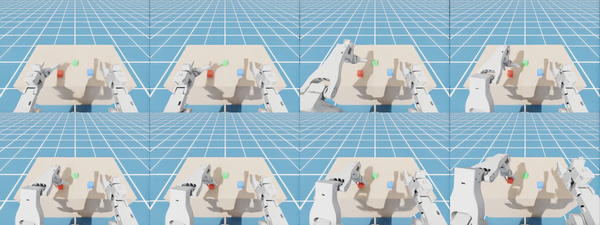
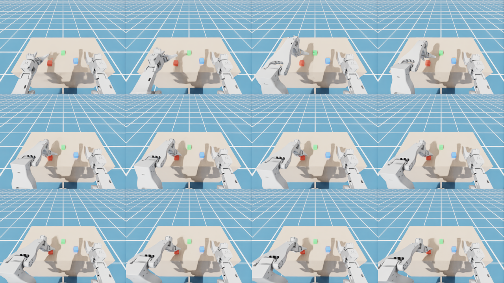

# ACT 与 GR00T N1.7 仿真对比报告

日期：2026-10-09　环境：Isaac Sim 6.1 + LeRobot 0.6.1，RTX PRO 4500 Blackwell 32 GB

## 结论

两种模型都能在仿真里学会「左臂抓起红色方块」，流程从示范生成、训练到闭环评估全部跑通。在这个单任务上，**ACT 更准、更省资源**：40 个评估回合成功 39 个，GR00T 成功 31 个。GR00T 的失败几乎都是同一种「没夹住」，而且受显存限制只做了部分微调，这个差距不能代表 GR00T 的上限。

## 设置

- **任务**：红色方块（4 cm，30 g）随机放在 x ∈ [0.07, 0.17] m、y ∈ [−0.40, −0.36] m，左臂抓起并升高 5 cm 以上算成功。
- **数据**：50 条脚本示范（IK 规划，约 7.5 s/条，共 11 250 帧），30 Hz；观测为 18 维状态 + 头部相机 + 左腕相机（320×240）；动作为 18 维关节目标。特征命名与真机 AlohaMini2 一致。
- **评估**：每个模型 20 个回合，方块位置用与训练不同的随机种子；另做 20 个回合把方块随机旋转 ±30°（示范里方块始终不旋转），检验泛化。两个模型面对的方块完全相同。
- **训练配置**
  - ACT：LeRobot 默认（ResNet18，动作块 100 步），batch 8，40k 步。
  - GR00T N1.7-3B：`new_embodiment`，动作块 16 步，相对动作（夹爪和底盘速度保持绝对值），bf16，batch 8，15k 步。**扩散动作头冻结**：完整的默认微调需要训练 1.6B 参数，单独占满 32 GB 显存仍然溢出，冻结后可训练参数为 529M、显存 19.7 GB。

## 结果

| 模型 | 可训练参数 | 训练 | 训练显存 | 成功率（标准） | 成功率（旋转 ±30°） | 平均抬升 | 平均抓起用时 | 推理 ms/步（平均 / 最大） | 推理显存 |
|---|---|---|---|---|---|---|---|---|---|
| ACT | 52M | 40k 步，39 min | 1.5 GB | **20/20（100%）** | **19/20（95%）** | 9.1 cm | 6.2 s | 1.4 / 9 | 0.2 GB |
| GR00T N1.7 | 529M | 15k 步，75 min | 19.6 GB | 16/20（80%） | 15/20（75%） | 9.5 cm | 7.9 s | 8.0 / 127 | 13.3 GB |

95% 置信区间：ACT 标准 84–100%，GR00T 标准 58–92%。单项 20 回合的差异不显著（p = 0.11、0.18，Fisher 精确检验），合计 40 回合 39 对 31 显著（p = 0.014）。推理延迟在空闲 GPU 上用真实示范帧测得。ACT 训练 10k 步时已经 10/10 成功。

## 观察

1. **GR00T 的失败模式单一**：9 次失败都是方块只升高 0–1.6 cm，也就是夹爪没有夹住方块（不是夹起后掉落）。其中 7 次方块在 y ≈ −0.39 m 一带，也就是工作区远端。
2. **GR00T 有随机性**：同一个方块位置，标准测试成功，旋转测试里只转了 −2° 却失败。GR00T 的动作从随机噪声采样（flow matching），同一场景每次结果可能不同；ACT 评估时是确定性的。
3. **对旋转都不敏感**：两者旋转后成功率只降了 5 个百分点。ACT 唯一的旋转失败在 −30°：夹起 7.6 cm 后掉落，而 GR00T 在同一个方块上成功了。
4. **实时性**：两者平均都远低于 30 Hz 的 33 ms 预算。但 GR00T 每 16 步要算一次动作块，耗时 127 ms（约 4 个控制周期）。仿真里会等模型算完；真机上需要异步推理，否则每 16 步会卡顿一下。

## 局限

- 只有一个任务、一种物体，示范由脚本生成、动作高度一致。这种设置对小模型 ACT 有利，体现不出 GR00T 语言理解和多任务泛化的优势。
- GR00T 是在显存限制下的「轻量微调」：动作头冻结，batch 8（官方示例 64），15k 步。
- 全部在仿真里：没有 sim2real 差距（光照、纹理、镜头畸变、舵机响应），真机效果需另行验证。
- 每项只有 20 个回合，单项结论的统计把握有限。

## 下一步

1. 在 40 GB 以上显存的机器上做 GR00T 完整微调（不冻结动作头，batch 32–64），这也是课程大纲第二节第 5 项本来的安排。
2. 做多任务、带不同语言指令的数据（抓不同颜色的方块、双臂交接），这才是 GR00T 的优势所在。
3. 增加示范的多样性：随机化方块朝向、光照、纹理，并接入 Mimic 扩增。
4. 用真机标定文件把关节值换算到真机单位，用同一套评估流程对比仿真和真机。

## 代码

| 文件 | 作用 |
|---|---|
| `lessons/05_demo_data/gen_demos.py` / `make_dataset.py` | Isaac Sim 里生成脚本示范，转成 LeRobot v3 数据集 |
| `lessons/06_act/train_act.sh` / `eval_act.sh` | 训练和评估 ACT |
| `lessons/07_groot/train_groot.sh` / `eval_groot.sh` | 微调和评估 GR00T |
| `lessons/08_compare_demo/run_comparison.sh` | 一键对比：延迟基准、两种评估、结果表 |
| `lessons/08_compare_demo/demo.sh` | 仿真窗口里现场演示两个模型 |
| `tools/serve_policy.py` | 加载任意 LeRobot 模型并通过 TCP 提供动作（GR00T 相对动作按整块推理） |
| `tools/eval_in_sim.py` / `tools/run_eval.sh` | Isaac Sim 闭环评估（可加方块旋转） |
| `common/policy_io.py` | 两个 Python 环境共用的特征定义、工作区范围和通信协议 |

各节的运行说明见对应目录的 `README.md`。
