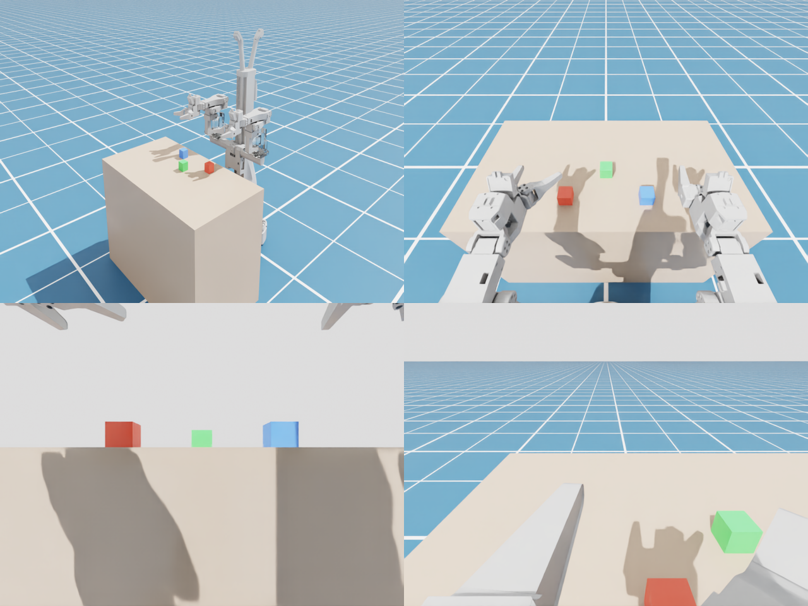
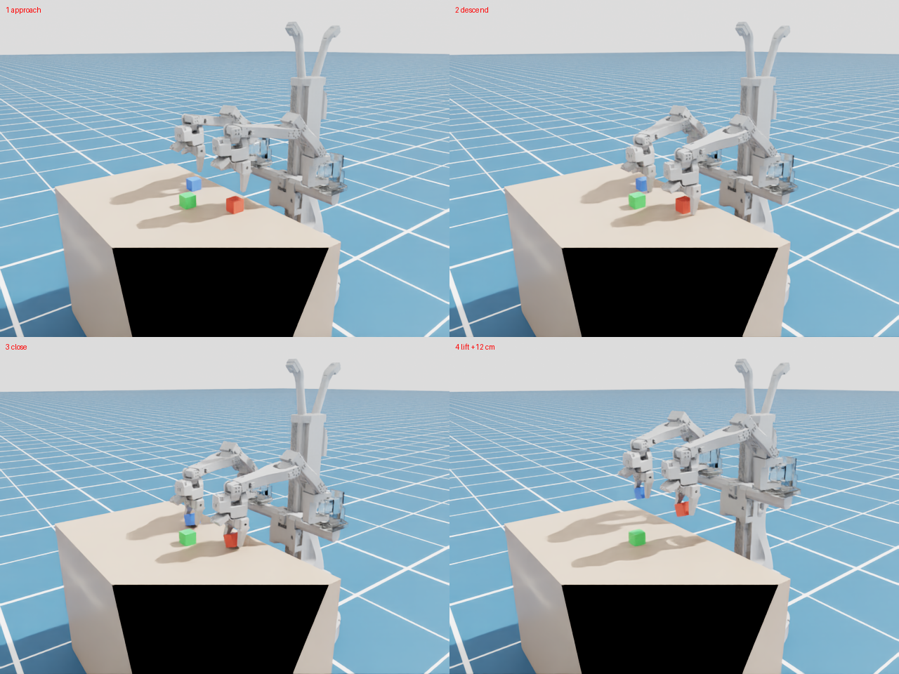

# AlohaMini2 × Isaac Sim 技术可行性测试报告（第一轮）

日期：2026-10-08　环境：RTX PRO 4500 Blackwell 32GB，Isaac Sim 6.1.0（docker 镜像 `nvcr.io/nvidia/isaac-sim:6.1.0`，headless）

对应大纲「二、教师开课前的准备」第 1 项（URDF → USD 数字孪生，校准关节、驱动参数和 5 个摄像头），以及第 4 项中 GR00T 动作空间的风险评估。

## 结论

**可行。** AlohaMini2 的官方 URDF 能导入 Isaac Sim 6.1，修正后得到 18 自由度的数字孪生（双臂 2×(6+1)、升降 1、底盘 x/y/yaw 3）。关节控制、升降、全向底盘速度控制、5 路摄像头渲染都已跑通，所有测试可以一键复现（`tools/run_checks.sh`，约 6 分钟）。

但**官方 URDF 不能直接用**。它是 SolidWorks 直接导出的，有 6 处会让仿真出错的问题，`lessons/01_urdf_to_usd/fix_urdf.py` 已经全部自动修正。另外还有 3 项必须在真机上测量才能完成（见「待办」）。

| 大纲中的事项 | 状态 | 说明 |
|---|---|---|
| URDF 导入 Isaac Sim 生成 USD | ✅ 通过 | 导入约 5 秒，网格从 121 MB 的 STL 压缩到 29 MB 的 USD |
| 校准驱动参数 | ✅ 仿真侧通过 | 按舵机型号配置力矩和速度上限、PD 增益 |
| 校准关节方向和零位 | ⚠️ 需要真机 | 换算公式已确定，缺每台机器人的标定文件 |
| 5 个摄像头的位置 | ✅ 位姿通过 / ⚠️ 内参需要实测 | 真实镜头有明显桶形畸变 |
| 底盘与升降 | ✅ 通过 | 底盘采用和真机一致的速度接口 `x.vel / y.vel / theta.vel` |
| GR00T N1.7 能否使用关节空间数据（大纲第 4 项的风险） | ✅ 风险可以排除 | 见第 5 节 |

## 1. 数据资产

| 来源 | 内容 |
|---|---|
| `third_party/AlohaMini`（liyiteng/AlohaMini） | 官方硬件仓库。`AlohaMini2/urdf/` 下有 alohamini2 和 alohamini2pro 两份 URDF |
| `third_party/lerobot_alohamini` | 官方 LeRobot 软件，定义了关节命名、舵机型号、归一化方式，还集成了 groot 策略 |
| `third_party/AM-ARM` | 机械臂硬件仓库，用来核对舵机配置 |
| HF 数据集 `yj678/alohamini2_move_test` | 公开的 AlohaMini2 真机录制（899 帧，30 fps，有胸前和双腕视频），用来对比真机与仿真 |

注意：AlohaMini1 是 5+1 自由度（SO-ARM），**和大纲一致的 6+1 自由度是 AlohaMini2**。lerobot_alohamini 里 `video2sim` 自带的 Isaac 资产是另一个变体（Pro + 平行夹爪），它的相机配置套到 AlohaMini2 的 URDF 上是错的（见第 4 节）。

## 2. 官方 URDF 的问题与修正（`lessons/01_urdf_to_usd/fix_urdf.py`）

| # | 问题 | 后果 | 修正 |
|---|---|---|---|
| 1 | 5 个相机和 3 个轮子都是 CAD 默认质量，**每个 10.095 kg**；腕部相机 1.27 kg | 整机重 75.5 kg（实际约 14 kg）；腕部相机比机械臂的 1 kg 负载还重 | 相机改为 0.03–0.05 kg，轮子改为 0.45 kg，惯量按同样比例缩放 |
| 2 | 所有关节都是 `effort="0" velocity="0"` | 导入器把 0 当成**无限力矩** | 按舵机设定：STS3095（肩部和肘部）7.45 N·m，STS3215（腕部和夹爪）2.35 N·m（取堵转力矩的 80%），升降 223 N |
| 3 | 网格路径用 `package://` | 需要 ROS 包路径 | 改成相对路径 |
| 4 | 虚拟底盘链 root→x→y→yaw 的 link 质量为 0 | `fix_base` 把 root_x_link 焊在世界上，**x 方向的自由度丢失** | 给虚拟 link 加质量 |
| 5 | 同上，虚拟 link 质量不能太小 | 用 0.01 kg（和整机质量比 1:1400）时 PhysX 求解器发散，底盘被甩出 4–7 m | 改为 1 kg（总质量 16.9 kg，其中 2 kg 是虚拟质量，不影响机械臂动力学） |
| 6 | 3 个轮子的碰撞体正好贴在 z=0 的地面上 | 和地面摩擦，底盘漂移 | 移除轮子的碰撞体（底盘由虚拟关节驱动） |

**关节限位仍然是 CAD 导出的 ±3.14**，还没有修改，需要用真机标定得到的实际范围替换。

## 3. 物理测试结果（`lessons/02_twin_check/check_physics.py`，PhysX，dt = 5 ms）

| 测试 | 结果 |
|---|---|
| A. 力矩裕量（100 个随机姿态，静态保持力矩 / 舵机上限） | 最差的是 wrist_flex，0.80 / 2.35 N·m，**占 34%**；STS3095 驱动的三个关节裕量更大 |
| B. 重力保持（零位，3 秒） | 最大误差 0.016 rad，升降误差 1.9 mm |
| C. 正弦跟踪（全部臂关节，0.5 Hz，±0.4 rad） | RMS 误差 0.043 rad，滞后 45 ms（和总线舵机的量级相近，之后用真机数据做系统辨识） |
| D. 升降 | 能到达 −0.3 和 +0.3 两端；下降 0.1 m/s，上升约 0.07 m/s |
| D. 底盘（机体系速度控制，4 秒） | 前进、横移、自转、圆弧、斜行加旋转，位置误差 ≤ 2 mm，偏航误差 ≤ 0.002 rad |
| E. 打开自碰撞 | 稳定，最大速度 0.07 rad/s |
| F. 速度 | 单机器人 CPU 物理约 1.4 倍实时（Isaac Lab 用 GPU 多环境并行，不受这个数字限制） |

几何上（`outputs/twin_check/geometry_*.json`），升降关节 q ∈ [−0.3, 0.3] m 对应 vertical_link 的高度变化 1:1，夹爪高度范围 0.43–1.03 m，胸前相机高度范围 0.24–0.84 m。真机的 `lift_axis.height_mm` ∈ [0, 600]，对应关系是 `q = height_mm / 1000 − 0.3`（零点仍需真机确认）。

## 4. 摄像头（`lessons/02_twin_check/check_cameras.py`）

- **相机位姿**：相机直接挂在 URDF 的 5 个相机 link 上。从网格分析可知，镜头筒（半径 6.8 mm）在 link 的 +z 方向，所以光轴是 +z，镜头前端在 z = 19 mm。胸前、前置、后置三个相机还需要绕光轴转 90°，画面才是水平的。
- 和真机画面对比（`images/real_grid.png`）：胸前相机水平朝前、腕部相机画面底部能看到夹爪，这两点和仿真一致。
- 社区提供的 `cameras_am2pro.yaml` 用在 AlohaMini2 上时，胸前、前置、后置三个相机都在机身内部（画面全黑），所以不能用。
- **视觉上的 sim2real 差距**：真实相机（2.4 mm 镜头）有明显的桶形畸变，视场角大于假设的 90°；仿真目前用的是针孔模型。需要用棋盘格标定内参和畸变系数，再在 Isaac 里换成对应的畸变模型。这一项可以直接作为第 25–26 课的教学素材。
- 课程设计提示：升降处于 0 位时，胸前相机高度 0.54 m，和 0.55 m 的桌面差不多高，只能看到桌子的侧面。**桌子高度和升降位置要一起设计。**

## 5. 和 LeRobot / GR00T 的数据接口

- **状态和动作是 18 维**：`arm_{left,right}_{shoulder_pan, shoulder_lift, elbow_flex, wrist_flex, wrist_yaw, wrist_roll, gripper}.pos`（14 维）+ `x.vel, y.vel, theta.vel` + `lift_axis.height_mm`。这和仿真的 18 个自由度一一对应（底盘在仿真里也用速度控制）。
- **真机关节值是归一化的**（`use_degrees=False` 时为 −100..100，夹爪为 0..100），不是弧度。换算公式（来自 `lerobot/motors/motors_bus.py`）：
  `raw = min + (norm + 100) / 200 · (max − min)`（如果 drive_mode 为真，先对 norm 取反），`angle = (raw − 2047) · 2π / 4096`，`q_sim = sign_j · angle + offset_j`。
  其中 min、max 来自每台机器人的标定 json，sign 和 offset 要把真机摆到已知姿态测一次。**公开数据集里不带标定文件，所以本轮没有做真机轨迹回放。**
- **GR00T N1.7**：lerobot_alohamini 已经集成了 `policies/groot`（N1.7）。默认 `embodiment_tag="new_embodiment"`，`use_relative_actions=False`（绝对动作），`max_state_dim = max_action_dim = 132`，远大于 18。也就是说，**末端相对动作只是可选项，可以直接用关节空间的绝对动作微调**，大纲第 4 项提到的「动作空间对接」风险可以排除。不过还没有做实际微调验证。

## 6. 踩过的坑（Isaac Sim 6.1）

1. 导入器把物理参数放在 USD 的 `Physics` variant 里（mujoco / physics / physx），**默认一个都不选**。引用时要设置 `variants=[("Physics","physx")]`。
2. 导入器不写 PhysX 的 `maxJointVelocity`（只写 `newton:velocityLimit`），PD 增益也全是 0，这两项都要在代码里设置。
3. articulation 静止一段时间后会进入休眠，之后用 tensor API 写入目标也不会唤醒它（表现为机械臂"冻住"）。要给 root 加上 `PhysxArticulationAPI`，把 `sleepThreshold` 设为 0。
4. `get_dof_gravity_compensation_forces()` 在这个资产上返回的 DOF 顺序不对（156 N 的整机重量出现在升降关节上）。所以力矩改用刚性 PD 保持来实测。
5. `get_dof_positions().numpy()` 返回的是会被复用的缓冲区，记录轨迹时必须 `.copy()`。
6. 虚拟底盘的关节同时加速度上限和高刚度位置控制时会发散。底盘应该用速度控制（和真机接口一致）。

## 7. 第二轮：交互仿真与双臂抓取（`lessons/03_sim_teleop`、`lessons/04_ik_grasp`）

在本机桌面（DCV `console` 会话）上搭了一个可交互的 Isaac Sim 环境：`lessons/03_sim_teleop/run_gui.sh` 启动，用法见该目录的 `README.md`。键盘控制底盘和升降（按键和真机遥控一致），滑块控制每个关节，另有预设姿态、双臂抓取和放回、演示巡游。

- **关节方向**（在数字孪生上逐个关节测得，真机仍需核对）：shoulder_lift 正值抬臂（−1.5 时夹爪从 0.73 m 降到 0.56 m）；elbow_flex 正值抬起小臂；wrist_flex 正值让夹爪向下；gripper 负值张开、约 0.8 闭合。
- **IK**（`common/alohamini_ik.py`）：6 维任务，约束抓取点位置、手指朝下，以及夹爪闭合方向与方块边平行。2 mm 以内收敛，十几次迭代。
- **双臂抓取**（`lessons/04_ik_grasp/grasp_ik.py`）：两只手同时抓起左右两个 4 cm、30 g 的方块，升降上抬 12 cm 后方块升高 10.7 cm，夹爪停在 0.33 rad 夹紧。用凸包碰撞体就能抓，凸分解没有带来差别。
- **桌子要贴近机器人**：底盘前缘在 y = −0.215 m，双臂零位时夹爪只到 y ≈ −0.28 m。桌边放在 y = −0.30 m、方块在 y = −0.40 m 时才在可达范围内。**课程场景布置时，桌边离机器人中心不要超过约 0.3 m。**
- **实时性**：显卡与 `ai4s_demo` 共用时，GUI 加 4 路相机窗口约 18 fps。程序按墙钟时间补算物理步，仿真速度约 0.6–0.95 倍实时。

这一轮又踩到 4 个坑：

7. 关节坐标系和直觉不一致，预设姿态不能凭感觉写，要先渲染或算出夹爪位置再定。
8. 夹爪是 SO-100 式单指旋转结构。抓取点不在夹爪 link 的原点，而是在固定指内侧面外 2 cm 处；只把 link 原点对准方块时，手指会压在方块顶上。另外夹爪闭合方向和方块边差 10° 时，方块的角也会顶住手指，所以 IK 要约束绕手指轴的转角。
9. `get_jacobian_matrices()` 在这个资产上的行列布局也不对（同第 4 条），IK 改用由连杆位姿数值差分得到的雅可比。
10. 底盘用纯速度控制时，零指令长时间静止也会漂移（14 小时漂了 0.6 m）。现在松开按键后切换为当前位置保持。

## 8. 待办（按优先级）

**需要真机（大约 0.5–1 天）**
1. 拷贝每台机器人的标定 json，测量每个关节的 sign 和 offset，得到 `q_sim ↔ norm` 的映射，然后用真机录制的轨迹在仿真里回放，逐帧对比 5 路画面。
2. 测量关节实际限位，替换 URDF 里的 ±3.14；称量相机和轮子的实际质量。
3. 用棋盘格标定 5 个相机的内参和畸变；根据真机画面微调相机外参和图像旋转方向。
4. 舵机阶跃响应测试，用来做系统辨识，回写仿真里的 PD 增益和延迟（第 25 课也会用到）。

**纯软件（下一轮可以做）**
5. 安装 Isaac Lab（需要和 Isaac Sim 6.1 版本匹配），把这份 USD 包装成 ArticulationCfg，搭一个抓放任务，测试多环境并行的吞吐量。
6. 跑通 Isaac Lab Mimic：少量示范 → 扩增 → 用 `lerobot_bridge` 导出成 LeRobot 数据集。
7. ~~GR00T 小规模微调冒烟测试~~：已完成，在 32 GB 显卡上用部分微调跑通，见 `lessons/07_groot` 和 `docs/act_vs_groot_report.md`。
8. 主臂 → Isaac Sim 遥操作：读取主臂（同样是归一化值）→ 上面的映射 → 设置仿真的位置目标。代码路径已经清楚，需要主臂硬件联调。

## 代码

代码已整理成课程结构，见仓库根目录的 `README.md`：第 01–04 节对应本报告的内容，`tools/run_checks.sh` 可以一键复现第 1–3、7 部分的测试。
