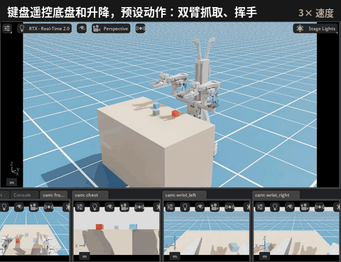

# 03 仿真遥操作：键盘和滑块

对应大纲：第 6 课「走进 Isaac Sim」（界面操作、拖动关节、调升降），第 7 课「搭建任务场景」，第 8 课「仿真遥操作」，第 9 课「双臂与移动操作」。



## 目标

- 熟悉 Isaac Sim 界面：3D 视图、Stage、机器人自身的相机画面。
- 用和真机一样的按键开底盘、调升降，用滑块控制每个关节。
- 体会关节空间：每个关节转动时，夹爪怎么动。

## 运行

```bash
lessons/03_sim_teleop/run_gui.sh            # 在主机屏幕上打开仿真窗口（要在桌面的终端里运行）
lessons/03_sim_teleop/run_gui.sh stop       # 关闭
SIM_AUTODEMO=1 lessons/03_sim_teleop/run_gui.sh   # 启动后自动播放演示（底盘、升降、双臂抓取、挥手）
```

约 1 分钟后窗口出现，第一次启动要编译着色器会更久。查看日志：`docker logs -f duo-arm-sim`。还没做第 01 节时，脚本会先自动生成数字孪生。

## 操作

先用鼠标点一下 3D 视图，键盘才会生效。按键和真机 lerobot_alohamini 的键盘遥控一致：

| 按键 | 动作 |
|---|---|
| W / S | 底盘前进 / 后退 |
| Z / X | 底盘左移 / 右移 |
| A / D | 底盘左转 / 右转 |
| U / J | 升降 上 / 下 |
| T / G | 底盘速度 加 / 减（0.1 / 0.2 / 0.3 m/s） |

右侧 **AlohaMini2 Control** 面板：

- **Policy demo**（顶部）：训练好的 ACT / GR00T 抓红色方块，见第 08 节。
- **Pick cubes**：双臂同时抓起左右两个方块并升起 12 cm（动作由启动时的逆运动学规划，见第 04 节）。**Place back**：放回原处。
- **Wave**：右臂挥手。**Play demo tour**：依次演示底盘移动、升降、双臂抓取和放回、挥手。
- **Home / Tuck / Arms up**：预设姿态。**Open / Close grippers**：开合夹爪。**Reset scene**：机器人和方块回到初始状态。
- 下方滑块：直接控制每个关节（弧度）。拖动滑块会中断正在执行的动作。

底部是机器人自身的 4 路相机：头部（front）、胸前（chest）、左腕、右腕。

## 讲解要点

- **关节方向**（在数字孪生上测得）：shoulder_lift 正值抬臂；elbow_flex 正值抬起小臂；wrist_flex 正值让夹爪向下；gripper 负值张开，0.8 左右闭合。
- **全向底盘**：按 Z / X 可以直接横着走，对应大纲第 4 课「全向轮为什么能横着走」。
- **升降**：0 位时夹爪高约 0.73 m，范围 ±0.3 m。状态行里的 `lift` 换算成了真机的 `height_mm`（0–600 mm）。
- **仿真速度**：渲染跟不上 60 fps 时，程序会补算物理步，让仿真接近实时；状态行的 `sim speed` 是当前倍率。

## 课堂练习

1. 只用滑块，让左臂夹爪停在红色方块正上方。记下 6 个关节角，再按 Pick cubes 对比逆运动学算出的姿态。
2. 中间的绿色方块在逆运动学规划范围之外。用键盘移动底盘、调升降，再配合滑块，试着把它抓起来。
3. 比赛：从同一个起点出发，用键盘把机器人开到桌子另一侧再回来，看谁用时最短、碰撞最少。

## 常见问题

**一直弹「Isaac Sim 无响应」**：这是 Ubuntu 桌面（GNOME）的检测，窗口 5 秒内没回应就弹窗，点「等待」即可继续使用。可以把超时改成 60 秒：`gsettings set org.gnome.mutter check-alive-timeout 60000`（恢复默认改成 5000）。

**窗口打不开，提示 `no X cookie found` 或 `cannot open display`**：要在主机桌面上的终端里运行，不要通过 SSH 运行。还不行就先运行 `xhost +local:`。

## 文件

- `sim_app.py`：场景、键盘和滑块控制、预设动作、策略演示面板。
- `run_gui.sh`：用 docker 启动仿真窗口。
